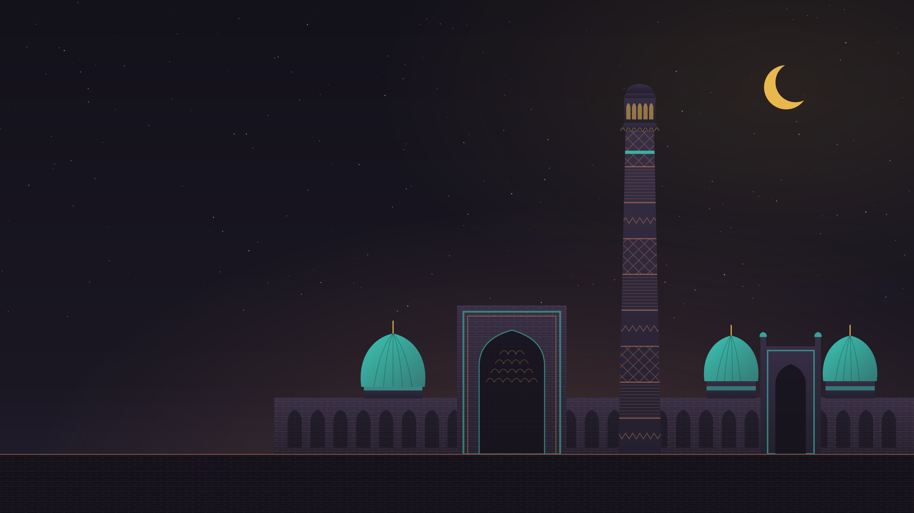
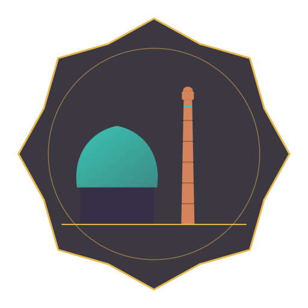
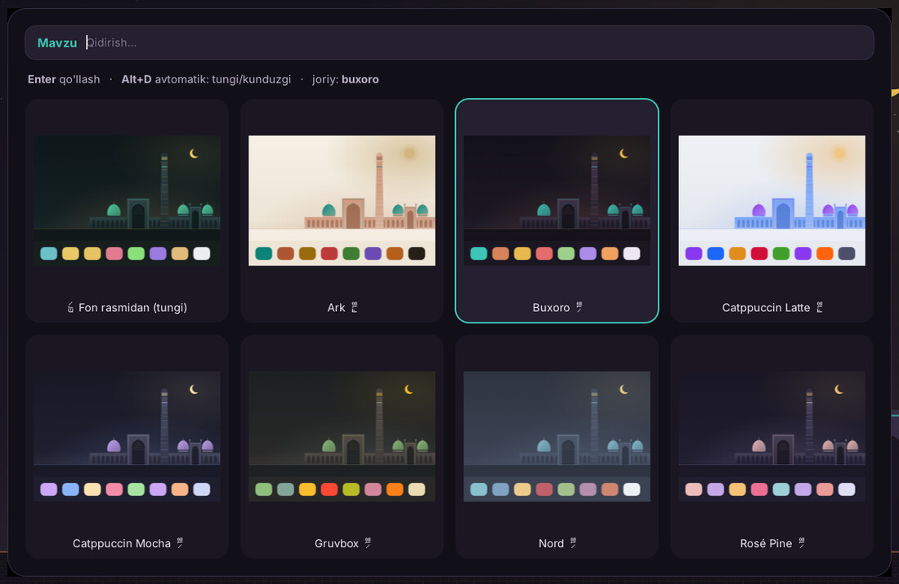
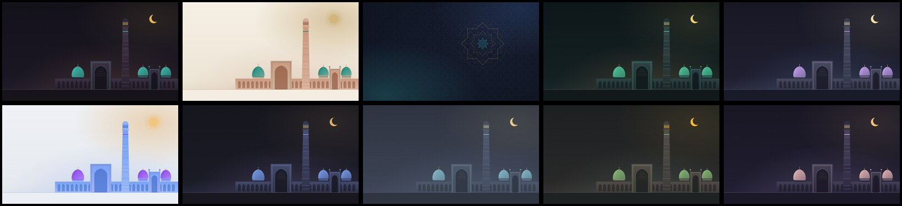

<div align="center">





# Buxoro

**Arch Linux + Hyprland uchun tez va chiroyli muhit: yoqish tugmasidan ish stoligacha**

Poyi Kalon ilhomidagi dizayn · Hyprland 0.55+ Lua konfiguratsiyasi · boshqaruv markazi · Buxoro splash, login va GRUB/Limine mavzulari · printer boshqaruvi · LaTeX uchun Neovim

</div>

> [!NOTE]
> O‘z ish stolingiz skrinshotini `assets/screenshot.png` sifatida qo‘shing (SUPER + SHIFT + S).

## Yoqishdan ish stoligacha

| Bosqich | Nima ko‘rasiz | Dastur |
| --- | --- | --- |
| Bootloader | Buxoro foni, oltin sarlavha, 2 soniyalik menyu (systemd-boot’da menyu yashirin) | GRUB / Limine / systemd-boot |
| Splash | Poyi Kalon siluyeti, asta paydo bo‘ladigan gerb, oltin nuqtalar; LUKS paroli uchun maydon | **Plymouth** (Buxoro mavzusi) |
| Login | Xiralashgan Buxoro fonida karta, soat, sessiya tanlash | **greetd + ReGreet** (GTK4, cage ichida) |
| Ish stoli | Orolcha-panel, nurli oyna chegaralari, bildirishnomalar markazi | **Hyprland** + Waybar + swaync |
| Qulflash | Xiralashgan ekran, katta soat, o‘zbekcha sana | **hyprlock** |

## Komponentlar

| Vazifa | Dastur | Nega aynan shu |
| --- | --- | --- |
| Kompozitor | **Hyprland** (Lua) | Animatsiya, xiralik, faol oyna nuri (glow); modulli `hyprland.lua` |
| Panel | **Waybar** | Musiqa, printer navbati, yangilanishlar soni, apparat holati |
| Bildirishnomalar markazi | **swaync** | Taqvim, Wi-Fi/Bluetooth/tungi yorug‘lik tugmalari, ovoz (har bir dastur uchun) va yorug‘lik slayderlari, musiqa pleyeri, quvvat menyusi |
| Ekrandagi ko‘rsatkich | **SwayOSD** | Ovoz, yorug‘lik, Caps Lock — gradientli tasma |
| Dasturlar menyusi | **fuzzel** | Waylandga xos, bir zumda ochiladi |
| Terminal | **foot** (server) | Eng tez Wayland terminali |
| Login | **greetd + ReGreet** | SDDM va GDM’dan ancha yengil, CSS bilan bezaladi |
| Splash | **Plymouth** | Buxoro mavzusi, shifrlangan disk paroli bilan |
| Printer | **CUPS** + drayversiz IPP + **bx-printer** | Avtomatik topish, ko‘p nusxa muammosini tuzatish |
| Shell | **zsh** + starship + fzf + zoxide | Plagin menejerisiz |
| Muharrir | **Neovim** + VimTeX + texlab + blink.cmp | LaTeX → Zathura, SyncTeX |
| Fayllar | **yazi**, Thunar | yazi asinxron va Rust’da yozilgan |
| Fon rasmi | **awww** | Silliq o‘tishlar: kursordan o‘suvchi doira, to‘lqin, chiziq; GIF animatsiyalar |
| Galereya | **rofi** + **bx-picker** | Mavzu kartochkalari va fon rasmlari to‘ri |
| Avtomatik ranglar | **bx-colors** | Istalgan rasmdan palitra (Material You uslubida, qo‘shimcha dasturisiz) |

## Nega tez

Hamma joyda bir tamoyil: chiroyli effekt faqat GPU’ni ortiqcha band qilmasa qoldiriladi.

- **Hyprland.** Xiralik 2 o‘tishda; nofaol oynalar shaffof emas, shuning uchun ularning ortidagi xiralik hisoblanmaydi. Ekran faqat o‘zgarish bo‘lganda chiziladi (VFR). Ikki videokartali noutbukda ish stolini ichki karta chizadi.
- **O‘yin rejimi** (`SUPER + ALT + G`). Animatsiya, xiralik, soya, nur va bo‘shliqlar bitta tugma bilan o‘chadi.
- **foot server rejimi.** Yangi terminal oynasi tayyor jarayondan bir zumda ochiladi.
- **zsh.** Plagin menejeri yo‘q, avtoto‘ldirish keshi kuniga bir marta yangilanadi.
- **Neovim.** Plaginlar faqat kerak bo‘lganda yuklanadi, ishlatilmaydigan standart plaginlar o‘chirilgan.
- **Yuklanish.** `NetworkManager-wait-online` o‘chirilgan (odatda 5–30 soniya tejaydi). Yuklanish jim o‘tadi va jurnal hajmi cheklangan.
- **Login.** greetd + cage — eng yengil grafik login yechimlaridan biri.

Raqamlarni o‘zingiz tekshiring: **`bx-doctor`** zsh va Neovim ishga tushish vaqtini, yuklanish vaqtini, eng sekin xizmatni, NVIDIA holatini va xatolarni ko‘rsatadi.

## O‘rnatish

```bash
git clone https://github.com/<foydalanuvchi>/buxoro ~/buxoro
cd ~/buxoro
./install.sh            # savollar bilan
./install.sh --latex    # LaTeX bilan (~1.5 GB)
./install.sh --boot     # bootloader va splash ham (savolsiz rejimda ham)
```

O‘rnatuvchi quyidagilarni bajaradi:

1. **Paketlar.** Rasmiy repozitoriyada topilmagan paketlar avtomatik ravishda AUR’dan olinadi.
2. **Printer.** Markani so‘raydi (HP, Canon, Epson, Brother, Samsung, Xerox) va kerak bo‘lsa drayver o‘rnatadi. Zamonaviy printerlar drayversiz ishlaydi.
3. **Konfiguratsiyalar.** Ular `~/.config` ga **simvolik havola** qilinadi, shuning uchun `git pull` darhol ishlaydi. Eski fayllar zaxiralanadi.
4. **Videokarta.** Ikki videokartali noutbukda ish stolini Intel chizadi, NVIDIA esa ishlatilmaganda uxlaydi (RTD3, ixtiyoriy).
5. **Login ekrani.** Buxoro login ekranini o‘rnatadi (SDDM yoki GDM o‘chiriladi).
6. **Bootloader.** Faqat aniq roziligingiz bilan: mavzu, Plymouth va tez yuklanish. Har bir o‘zgartirilgan fayl `.bx-backup-<sana>` nomi bilan zaxiralanadi.

Keyin kompyuterni qayta yuklang va hammasi to‘g‘ri ekanini `bx-doctor` bilan tekshiring.

## Tezkor tugmalar

Bu ro‘yxatni istalgan vaqtda **`SUPER + /`** bilan ochish mumkin. U `bx/binds.lua` dan avtomatik yaratiladi.

| Tugmalar | Vazifasi |
| --- | --- |
| `SUPER + Return` | Terminal (foot) |
| `SUPER + D` | Dasturlar menyusi (fuzzel) |
| `SUPER + E` | Fayl menejeri (yazi) |
| `SUPER + SHIFT + E` | Grafik fayl menejeri (Thunar) |
| `SUPER + B` | Brauzer |
| `SUPER + SHIFT + Return` | Neovim |
| `SUPER + CTRL + Escape` | Tizim monitori (btop) |
| `SUPER + C` | Bufer tarixi |
| `SUPER + period` | Emoji va belgilar |
| `SUPER + slash` | Shu ro'yxat |
| `SUPER + Q` | Oynani yopish |
| `SUPER + SHIFT + Q` | Oynani majburan yopish |
| `SUPER + F` | To'liq ekran |
| `SUPER + M` | Kattalashtirish (panel ko'rinadi) |
| `SUPER + V` | Suzuvchi / joylashtirilgan |
| `SUPER + SHIFT + P` | Barcha ish stollariga qadash |
| `SUPER + P` | Psevdo-joylashuv |
| `SUPER + O` | Bo'linish yo'nalishini almashtirish |
| `SUPER + G` | Guruh (tablar) yaratish/bekor qilish |
| `SUPER + bracketright` | Guruhda keyingi oyna |
| `SUPER + bracketleft` | Guruhda oldingi oyna |
| `ALT + Tab` | Oynalar orasida aylanish |
| `SUPER + ←↓↑→ / H J K L` | Fokusni ko'chirish |
| `SUPER + SHIFT + ←↓↑→ / H J K L` | Oynani ko'chirish |
| `SUPER + CTRL + ←↓↑→ / H J K L` | Oyna o'lchamini o'zgartirish |
| `SUPER + sichqoncha (chap/o'ng)` | Oynani sudrash / o'lchamini o'zgartirish |
| `SUPER + 1…0` | Ish stoliga o'tish |
| `SUPER + SHIFT + 1…0` | Oynani ish stoliga ko'chirish (birga o'tish) |
| `SUPER + CTRL + 1…0` | Oynani ish stoliga jimgina yuborish |
| `SUPER + Tab` | Oldingi ish stoli |
| `SUPER + grave` | Yashirin ish stoli (scratchpad) |
| `SUPER + SHIFT + grave` | Oynani yashirin ish stoliga |
| `SUPER + X` | Quvvat menyusi |
| `SUPER + ALT + L` | Ekranni qulflash |
| `SUPER + SHIFT + R` | Hyprland konfiguratsiyasini qayta yuklash |
| `SUPER + ALT + B` | Panelni yashirish/ko'rsatish |
| `SUPER + SHIFT + T` | Mavzular galereyasi (fon rasmidan avtomatik ham) |
| `SUPER + ALT + T` | Mavzu: tungi ↔ kunduzgi |
| `SUPER + W` | Fon rasmlari galereyasi |
| `SUPER + SHIFT + W` | Keyingi fon rasmi |
| `SUPER + ALT + W` | Tasodifiy fon rasmi |
| `SUPER + ALT + N` | Tungi yorug'lik (ko'z uchun) |
| `SUPER + ALT + P` | Ekrandan rang olish |
| `SUPER + N` | Boshqaruv markazi / bildirishnomalar |
| `SUPER + SHIFT + N` | Bildirishnomalarni tozalash |
| `SUPER + ALT + D` | Bezovta qilmaslik rejimi |
| `SUPER + ALT + R` | Printer menyusi |
| `SUPER + ALT + G` | O'yin rejimi (effektlarsiz) |
| `Print` | Skrinshot: hudud |
| `SHIFT + Print` | Skrinshot: butun ekran |
| `SUPER + Print` | Skrinshot: hudud + tahrirlash |
| `SUPER + SHIFT + S` | Skrinshot: hudud |
| `Fn + ovoz / yorug'lik tugmalari` | Ovoz, mikrofon va yorug'lik (ekranda ko'rsatkich bilan) |

Klaviatura tili **Alt + Shift** bilan almashtiriladi: inglizcha → o‘zbekcha (lotin) → ruscha.

## Boshqaruv markazi

`SUPER + N` yoki paneldagi qo‘ng‘iroqcha bilan ochiladi. Unda quyidagilar bor:

- **Yuqori qator:** sozlamalar va quvvat menyusi (qulflash, chiqish, uyqu, qayta yuklash, o‘chirish).
- **Taqvim.**
- **8 ta tez tugma:** Wi-Fi, Bluetooth, bezovta qilmaslik, tungi yorug‘lik, skrinshot, mavzu almashtirish, printer menyusi va o‘yin rejimi.
- **Ovoz slayderi.** Har bir dastur uchun alohida sozlash mumkin.
- **Yorug‘lik slayderi** va **musiqa pleyeri** (Firefox, Spotify, mpv…).
- **Bildirishnomalar tarixi** guruhlarga ajratilgan holda.

## Mavzu va fon galereyasi



**`SUPER + SHIFT + T` — mavzular galereyasi.** Har bir kartochkada mavzuning fon rasmi va palitrasi ko‘rinadi. Birinchi kartochka **«Fon rasmidan»**: joriy rasmdan avtomatik yaratilgan palitra. `Alt+D` uning tungi va kunduzgi variantlari orasida almashtiradi.

**`SUPER + W` — fon rasmlari galereyasi.** Unda repozitoriyadagi rasmlar va `~/Pictures/Wallpapers` papkasidagi rasmlaringiz (png, jpg, webp, animatsiyali gif) ko‘rinadi.

| Tugma | Vazifasi |
| --- | --- |
| `Alt+A` | **Ranglar rasmdan.** Yoqilgan bo‘lsa, rasm tanlanganda butun tizim palitrasi shu rasmga moslanadi |
| `Alt+T` | O‘tish effekti: `grow` (sichqoncha turgan joydan o‘suvchi doira) → `wave` → `wipe` → `outer` → `fade` → `random` → `none` |
| `Alt+R` | Tasodifiy rasm |
| `Alt+S` | Slayd-shou: har 30 daqiqada yangi rasm |

Terminaldan ham boshqarish mumkin:

```bash
bx-theme auto ~/Pictures/rasm.jpg light   # istalgan rasmdan kunduzgi palitra
bx-wall auto on                           # bundan keyin har bir rasm o'z ranglarini olib keladi
bx-wall transition wave
bx-wall slideshow start 15
```

## Printer

```bash
bx-printer add             # tarmoq/USB printerini avtomatik topib qo'shish (drayversiz)
bx-printer fix-copies      # "faqat 1 nusxa chiqadi" muammosini tuzatish
bx-printer print hujjat.pdf 3
bx-printer test            # sinov sahifasi
bx-printer                 # menyu (yoki SUPER + ALT + R)
```

**Ko‘p nusxa chiqmasligi haqida.** Ba’zi drayverlar «nusxalarni o‘zim chiqaraman» deb CUPS’ga xabar beradi, lekin bitta nusxa chiqaradi. `bx-printer fix-copies` printerning PPD fayliga `*cupsManualCopies: True` yozadi. Shundan keyin nusxalarni CUPS o‘zi yaratadi, va bu barcha dasturlarda, jumladan brauzerdagi chop etish oynasida ham ishlaydi. Agar bu ham yordam bermasa, `BX_COPIES=loop bx-printer print fayl.pdf 3` har bir nusxani alohida vazifa qilib yuboradi.

Paneldagi printer belgisi faqat navbatda vazifa bo‘lganda yoki xatolik yuz berganda ko‘rinadi. Tarmoq printerlari Avahi (mDNS) orqali, USB printerlar esa ipp-usb orqali drayversiz topiladi.

## Yuklanish va login

```bash
bx-boot status   # bootloader, splash, yuklanish vaqti, eng sekin xizmatlar
bx-boot all      # mavzu + Plymouth + tezlik (yoki alohida: theme | splash | speed)
bx-greeter install | preview | remove
```

| Bootloader | Nima qilinadi |
| --- | --- |
| **GRUB** | To‘liq mavzu: fon, Inter shriftlari (`grub-mkfont` bilan), feruza tanlov qatori, vaqt chizig‘i; menyu 2 soniya |
| **Limine** | Fon, oltin sarlavha, Buxoro terminal palitrasi; menyu 2 soniya |
| **systemd-boot** | Menyu yashirin (`timeout 0`) — eng tez variant. Yoqishda Probel bosib turilsa, menyu chiqadi |

Barcha holatlarda yadro parametrlariga `quiet splash` qo‘shiladi, shunda Plymouth splash ko‘rinadi. Parametrlar `/etc/kernel/cmdline` (UKI), systemd-boot yozuvlari, `/etc/default/grub` yoki `limine.conf` ga yoziladi.

## Mavzular



| Mavzu | Rejim | G‘oya |
| --- | --- | --- |
| **Buxoro** | tungi | Siyohrang tun, Mir-Arab feruzasi, Kalon g‘ishti, zardo‘zi oltini |
| **Ark** | kunduzgi | Ark devorlarining qumrang suvog‘i, to‘q feruza |
| **Samarqand** | tungi | Registon lojuvardi, girih (xotam) naqshli fon |
| **Xiva** | tungi | Kalta Minorning yashil-feruza koshini, qum rang devorlar |
| **Catppuccin Mocha / Latte** | tungi / kunduzgi | Mashhur pastel palitra |
| **Tokyo Night**, **Nord**, **Gruvbox**, **Rosé Pine** | tungi | Mashhur palitralar, Buxoro siluyeti bilan |
| **Fon rasmidan** | ikkalasi | Istalgan rasmdan avtomatik |

Mavzu almashtirilganda Hyprland, Waybar, swaync, SwayOSD, rofi, fuzzel, foot, hyprlock, Neovim (ochiq oynalar ham), Zathura, btop, fzf va GTK ilovalari birdaniga yangilanadi. `SUPER + ALT + T` tungi va kunduzgi juftlik orasida almashtiradi (Buxoro ↔ Ark, Mocha ↔ Latte, avtomatik mavzuda esa tungi ↔ kunduzgi).

**O‘z mavzuingizni yaratish:**
1. Istalgan `.theme` faylidan nusxa olib, uni `~/.config/buxoro/themes/` ga joylang va ranglarni o‘zgartiring. Mavzu galereyada o‘zi paydo bo‘ladi.
2. Fon rasmi kerak bo‘lsa, faylni repozitoriyaning `themes/` papkasiga qo‘yib, `python3 assets/make-wallpapers.py` ni ishga tushiring. Fayldagi `wallpaper_style` qiymati `kalon` yoki `girih` bo‘lishi mumkin.

## Skriptlar

| Buyruq | Vazifasi |
| --- | --- |
| `bx-doctor` | Tizim tekshiruvi va tezlik o‘lchovlari |
| `bx-picker` | Galereya: `theme`, `wallpaper` |
| `bx-theme` | Mavzu: `apply`, `auto`, `toggle`, `list` |
| `bx-colors` | Rasmdan palitra yaratish |
| `bx-sync` | GitHub’dan avtomatik yangilanish: `status`, `on`, `off`, `log` |
| `bx-boot` | Bootloader mavzusi, Plymouth, yuklanish tezligi |
| `bx-greeter` | Login ekrani |
| `bx-printer` | Printer: qo‘shish, nusxalarni tuzatish, chop etish, navbat |
| `bx-gamemode` | O‘yin rejimi |
| `bx-shot` | Skrinshot: `region`, `screen`, `edit` |
| `bx-wall` | Fon rasmi: `pick`, `next`, `random`, `set`, `auto`, `transition`, `slideshow` |
| `bx-clip` | Bufer tarixi |
| `bx-emoji` | Emoji, matematik belgilar (≤ ≠ √ π ∠ ℝ), o‘zbek tutuq belgisi ʻ |
| `bx-power` | Quvvat menyusi |
| `bx-nightlight` | Tungi yorug‘lik |
| `bx-keys` | Tugmalar ro‘yxati |
| `bx-update`, `bx-updates` | Yangilash va paneldagi yangilanishlar soni |

## Avtomatik yangilanish (GitHub → tizim)

Konfiguratsiyalar repozitoriyaga simvolik havola qilingani uchun, `git pull` qilishning o‘zi yetarli: o‘zgarishlar darhol ishlaydi. `bx-sync` taymeri buni avtomatik bajaradi:

1. Kompyuter yoqilgandan 2 daqiqa o‘tib, keyin esa har soatda GitHub tekshiriladi.
2. Yangi commit bo‘lsa, faqat xavfsiz usulda (*fast-forward*) yuklab olinadi. Sizning mahalliy o‘zgarishlaringiz hech qachon ustidan yozilmaydi: bunday holatda yangilanish to‘xtaydi va bildirishnoma keladi.
3. Ranglar qayta yaratiladi, ilovalar yangilanadi, yangi skriptlar `~/.local/bin` ga ulanadi.
4. Nima o‘zgargani haqida bildirishnoma keladi (commit xabarlari bilan).
5. Root huquqi kerak bo‘lgan qadamlar (yangi paketlar, bootloader) avtomatik bajarilmaydi, faqat eslatma chiqadi.

```bash
bx-sync status   # oxirgi tekshiruv, keyingi tekshiruv, bajarilishi kerak bo'lgan qadamlar
bx-sync          # hozir tekshirish
bx-sync on|off   # yoqish/o'chirish
bx-sync log      # jurnal
```

Ish tartibi: istalgan kompyuterda (yoki to‘g‘ridan-to‘g‘ri GitHub saytida) o‘zgartiring, `git push` qiling, va qolgan kompyuterlar bir soat ichida o‘zi yangilanadi. Repozitoriya yopiq (private) bo‘lsa, avval `gh auth login` qiling.

## LaTeX

Neovim’da `.tex` faylni oching va quyidagilardan foydalaning:

- `,ll` — lualatex bilan uzluksiz kompilyatsiya;
- `,lv` — PDF’ni Zathura’da ochish (SyncTeX bilan kursor joyi yoritiladi);
- Zathura’da **Ctrl + bosish** — Neovim’dagi tegishli qatorga qaytish;
- `,le` — xatolar ro‘yxati;
- terminalda: `tex fayl.tex`.

## Moslashtirish

Shaxsiy o‘zgarishlarni gitga kirmaydigan fayllarga yozing:

- `config/hypr/user.lua` — monitorlar, tugmalar, oyna qoidalari (`user.lua.example` dan nusxa oling);
- `config/zsh/local.zsh` — qo‘shimcha aliaslar va o‘zgaruvchilar.

Asosiy dasturlarni `config/hypr/bx/vars.lua` da almashtirish mumkin.

## Muammolarni hal qilish

| Muammo | Yechim |
| --- | --- |
| Biror narsa ishlamasa | `bx-doctor` |
| Hyprland xato ko‘rsatsa | `hyprctl configerrors` |
| Yorug‘lik slayderi ishlamasa | `ls /sys/class/backlight` natijasini `config/swaync/config.json` dagi `device` ga yozing |
| Login ekrani yoqmasa | TTY2 ga o‘ting (Ctrl+Alt+F2), `bx-greeter remove` va eski login manager’ni yoqing |
| Bootloader o‘zgarishini qaytarish | `.bx-backup-*` faylni asl nomiga qaytaring; GRUB uchun so‘ng `grub-mkconfig -o /boot/grub/grub.cfg` |
| Sana inglizcha chiqsa | `/etc/locale.gen` da `uz_UZ.UTF-8` ni yoqib, `sudo locale-gen` |

## Tuzilma

```
buxoro/
├── config/        → ~/.config (hypr, waybar, swaync, swayosd, foot, nvim, zsh, yazi, zathura, …)
├── templates/     rangli fayllar shablonlari — bx-theme render qiladi
├── themes/        buxoro.theme, ark.theme
├── boot/          GRUB va Limine mavzulari, Plymouth splash, greetd/ReGreet
├── bin/           bx-* skriptlari → ~/.local/bin
├── wallpapers/    Poyi Kalon fon rasmlari (SVG + PNG)
├── assets/        fon rasmlari va boot rasmlari generatorlari, gerb, belgilar ro‘yxati
├── packages*.txt  paketlar (asosiy, LaTeX, printer drayverlari, AUR)
└── install.sh
```

## Minnatdorchilik

Loyiha [serpantinum](https://github.com/ilyamiro/serpantinum) va Hyprland hamjamiyatidan ilhomlangan. Konfiguratsiyalar rasmiy manbalar asosida yozilgan: [Hyprland Lua namunasi](https://github.com/hyprwm/Hyprland/blob/main/example/hyprland.lua), [swaync](https://github.com/ErikReider/SwayNotificationCenter), [SwayOSD](https://github.com/ErikReider/SwayOSD), [ReGreet](https://github.com/rharish101/ReGreet) va [Limine](https://codeberg.org/Limine/Limine) hujjatlari.

## Litsenziya

[MIT](LICENSE)
